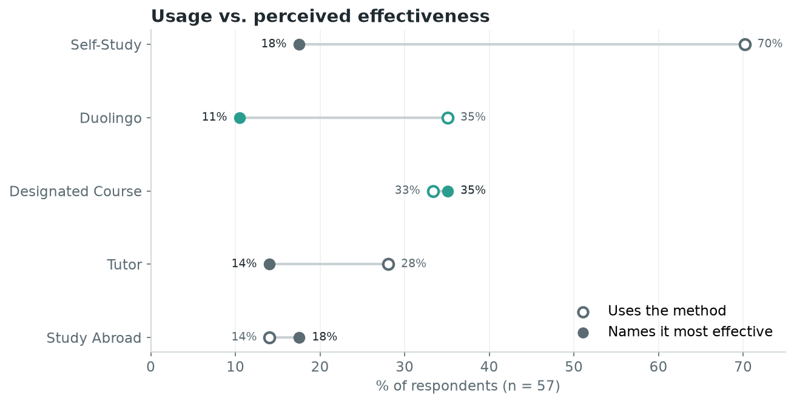
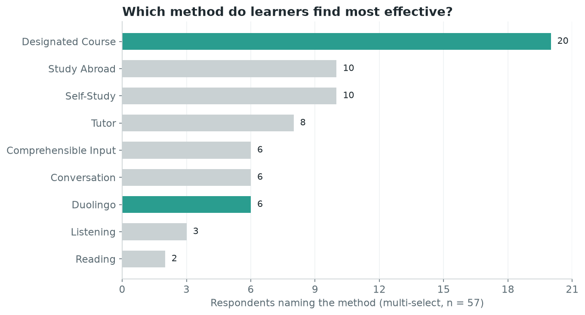
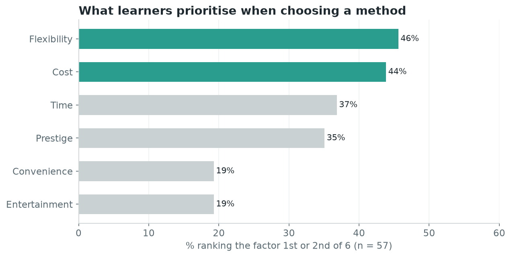
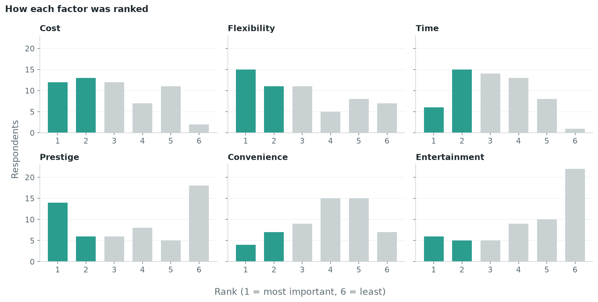
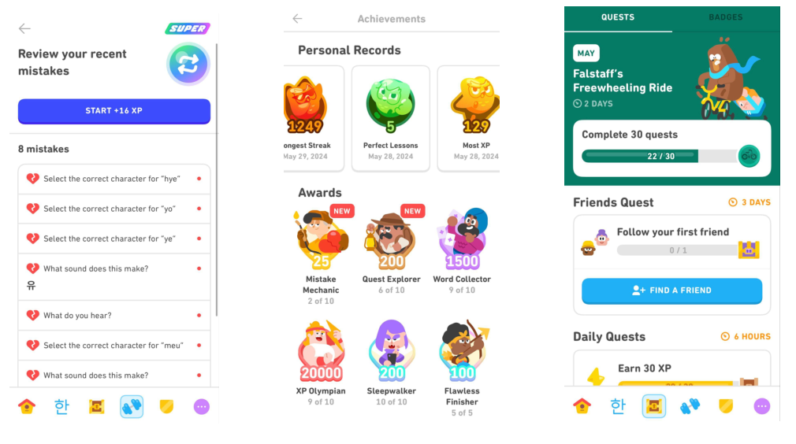

# Duolingo vs. the Classroom: How Learners Choose a Language Method

A mixed-methods study of 57 survey respondents, 8 interviews and a 30-day Duolingo case study. The research question was which way of learning a language works best for college-age learners, and what each learner should pick based on their own priorities. The outcome is a six-factor decision framework that recommends Duolingo or a classroom course.

**Skills shown:** survey design · data cleaning and analysis in Python (pandas, matplotlib, seaborn, plotly) · qualitative thematic coding · mixed-methods synthesis · turning research into a recommendation

---

## 📌 Key results

| | |
|---|---|
| **35% vs 11%** | 35% of respondents use Duolingo, but only 11% name it as their most effective method. |
| **20 of 57** | Designated courses were named most effective more often than any other method, about twice as often as the next ones (study abroad and self-study, 10 each). |
| **46%** | Flexibility was the factor most often ranked 1st or 2nd of 6, just ahead of cost (44%). Entertainment ranked last. |
| **5 themes** | Interviews with 8 UW students produced five recurring themes. Duolingo won on flexibility and engagement. Classes won on interaction, cultural context and real-world use. |



The gap above is the core finding. Duolingo is widely used as a supplement, but learners don't believe it carries them to proficiency. Designated courses and study abroad, the two structured, immersive options, are the only methods that more people name as most effective than currently use.

---

## 🎯 Problem

Most students choosing how to learn a language face the same fork: a free, flexible app or a structured, paid course. Advice is anecdotal. We set out to give learners a data-backed way to choose by measuring what learners prioritise, what they find effective, and why.

**Scope:** college-age learners in the U.S. (about 60% of U.S. language learners are under 30, per Duolingo). Classroom learners were recruited from University of Washington language courses. Survey respondents came from r/languagelearning.

---

## 🔬 Approach

| Method | What we did | What it answered |
|---|---|---|
| **Survey** (quantitative) | Qualtrics survey on r/languagelearning. About 10,000 views in 7 days, 59 responses, 57 usable. Respondents ranked six factors and named the methods they use and find most effective. | What learners prioritise; which methods they rate highest |
| **Interviews** (qualitative) | 8 UW undergraduates in Chinese courses, all with Duolingo experience. Coded with thematic analysis: initial coding, theme generation, review, naming. | *Why* learners prefer one method over another |
| **Case study** (experiential) | One team member did a Korean lesson on Duolingo every day for 30 days and kept a journal. | What daily app learning is actually like |

The survey data was cleaned and analysed in Python. The free-text "Other" answers were merged into the multi-select picklists, column names were normalised, and multi-answer fields were exploded so each method could be counted per respondent.

---

## 📊 Findings

### 1. Classroom courses are rated most effective



Respondents described classes as "structured", with "more opportunities to speak", and said classes made them "more motivated to learn".

### 2. Learners prioritise flexibility and cost, not fun



- **Flexibility** has a right-skewed ranking: most people put it near the top.
- **Entertainment** is clearly left-skewed. Gamification is not a reason people choose a method.
- **Prestige** splits into two camps. Some care a lot about credentials, others not at all.

<details>
<summary>Full rank distribution for each factor</summary>



</details>

### 3. Interviews explain the gap

| Theme | What we heard |
|---|---|
| Flexibility & engagement | Every participant valued fitting a Duolingo lesson into spare minutes. |
| Interaction & participation | Being able to ask professors and TAs, especially about pronunciation, was the main reason classes worked. |
| Application & cultural context | Duolingo lacks cultural context, which made it hard to use the language in real situations. |
| Oversimplification | Repeated pattern drills on Duolingo didn't carry over to everyday conversation. |
| Pronunciation & outcomes | Mixed. Classes were credited for grammar and sentence structure; one participant found Duolingo helpful for pronunciation. |

> "The structured, in-person classes are crucial for my learning. The interaction with professors and teaching assistants helps me grasp complex concepts more effectively." (Interviewee 6)

### 4. The case study: easy to start, hard to sustain



Five-minute lessons made daily practice possible even on busy days, and the gamified features kept it going. The catch is that without deadlines or a teacher, results depend entirely on self-discipline.

---

## ✅ Recommendation: a six-factor decision framework

Learners pick their **top three** priorities. Each priority maps to the method the evidence favours, and the majority decides.

| Favours **Classroom** | Evidence | Favours **Duolingo** | Evidence |
|---|---|---|---|
| Proficiency | Survey: courses rated most effective | Flexibility | Survey: top-ranked factor |
| Interaction | Interview theme | Time | Case study: 5-minute lessons |
| Prestige | Interview themes | Entertainment | Case study journal |

Three picks over two methods can't tie, so the result is always one of four splits: 3:0 or 2:1 toward either method. In the final presentation the framework ran as a live QR-code poll. This repo includes it as a small script:

```bash
python src/recommender.py flexibility time proficiency
# Recommendation: Duolingo  (Classroom 1 : Duolingo 2)
```

---

## 🧭 Limitations

- Non-probability sample from a single subreddit, so it skews toward highly engaged learners. Median age is 29, and 37 of 57 respondents are native English speakers.
- Only 8 interviews, all from Chinese courses at one university.
- The case study covered one person over 30 days. A longer run would say more about retention.
- The comparison covers only two methods. Self-study and tutoring came up often and are the obvious next categories to add.

---

## 🗂 Repository

```
├── data/survey_responses.csv     cleaned, anonymised survey responses (57 × 20)
├── src/analysis.py               rebuilds every chart in figures/ and prints the summary numbers
├── src/recommender.py            the decision framework as a CLI
├── figures/                      charts used in this README
├── notebooks/                    original exploratory notebooks from the project
└── docs/                         final report (16 pp.) and presentation deck
```

```bash
pip install -r requirements.txt
python src/analysis.py
```

The charts in `figures/` are a cleaned-up rebuild of the notebook charts from the same data. The original notebooks are kept as they were.

---

## 👥 Team

Built by a team of four for IMT 570 (Data-Driven Organizational Problem Solving) at the University of Washington Information School, Spring 2024.

- **Sam Wang**: project idea, survey data analysis and visualisation
- **Kevin Ko / Kevin Wen**: prototype development, product management and data cleaning
- **Kelvin Law**: 30-day case study, documentation and data visualisation

## 💻 Tech stack

Python · pandas · NumPy · matplotlib · seaborn · plotly · Jupyter · Qualtrics
